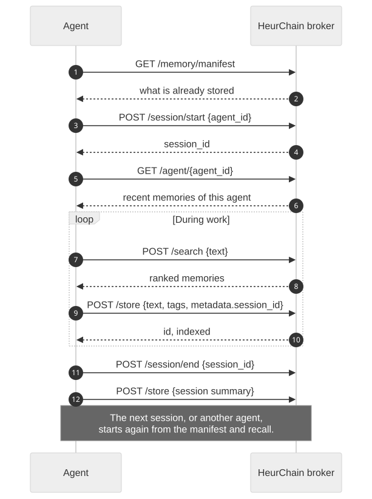

# HeurChain (self-hosted)

**One memory system for every AI agent you run, on your own infrastructure.**

[](https://github.com/peterjohannmedina/heurchain/actions/workflows/selfhost-smoke.yml)
[](https://www.npmjs.com/package/heurchain)
[](LICENSE)

HeurChain is a persistent memory broker for AI agents. Claude Code, Codex, Gemini, local
models and any HTTP or MCP client share one store. They write facts, decisions and session
summaries, and later recall them with hybrid search: keyword (BM25) and meaning (dense
vectors), fused into one ranking.

This repository is the **self-hosted edition**, and it is the complete package: the broker
source, a Docker Compose stack that builds and runs it with everything it needs, a systemd
unit for native installs, and the docs. No accounts, billing or cloud services are involved.

> **Broker version: 0.6.1-oss.1 (frozen).** This edition is cut from the 0.6.1 broker.
> Versions read `<mainline>-oss.<n>`, and `GET /health` reports `"edition": "oss"`. Changes
> here are limited to fixes and documentation; new broker features are not added to this
> line. See [CHANGELOG.md](CHANGELOG.md) for what differs from mainline 0.6.1.

### Where to get what

| You want to | Use |
|---|---|
| **Run HeurChain** (the memory server) | **This repository**: `git clone`, then `docker compose up` ([quick start](#quick-start)) |
| Point an agent at a running broker | The [`heurchain` npm package](https://www.npmjs.com/package/heurchain): `AGENT_CONFIG.json` and the onboarding guide. It contains no server. |
| The old 1.x Node.js server | Deprecated. Still installable as `heurchain@1`; see [Upgrading from 1.x](#upgrading-from-1x). |

## How it works



The broker is one Go binary listening on one port. Agents reach it over **MCP** (Claude Code
and other MCP clients) or plain **HTTP + JSON** (scripts, services, anything with `curl`).
Every request carries two headers, an API key and a tenant ID; each tenant is a separate
memory space for a person, team or project.

Behind the broker sit four services, all on your machine:

| Service | Holds | Needed? |
|---|---|---|
| **Redis** | The memory records themselves (text, tags, agent, session, timestamps), the BM25 keyword index, sessions and the vault | Yes. It is the source of truth. |
| **Embedder** | Turns text into vectors. Ollama with `nomic-embed-text` by default, or any OpenAI-compatible endpoint (OpenAI, TEI, vLLM, LM Studio) | Yes. `/store` returns 503 without it. |
| **Qdrant** | Dense vectors for search by meaning | Strongly recommended. Without it, stores succeed with an "indexing incomplete" warning and search falls back to keywords only. |
| **SQLite** (a file) | Tenants, API keys, audit log and usage counts. The schema is created on first start. | Yes, built into the broker. |

### Store and recall



- **Store.** The broker checks the key and tenant, embeds the text, writes the memory record
  to Redis, then indexes it twice: BM25 terms in Redis and a vector point in Qdrant. The
  write is recorded in the audit log.
- **Recall.** The query is embedded (repeat queries hit a cache), and both indexes return
  candidates. Reciprocal rank fusion (RRF) merges the two rankings, so a memory that matches
  on exact words *and* on meaning rises to the top. Agent, tag and date filters apply, and
  the response includes the scores and a `retrieval` block that says what each stage did.
- **Lifecycle.** Each memory has an activation score in the ACT-R style: every access
  raises it and time lowers it. A background worker moves memories whose activation falls
  below a threshold into the **vault**: kept and exportable, but no longer searched. It
  ships as a dry run (`promote_live: false`) that only logs what it would move.

### A session, step by step



Agents that follow this protocol pick up where they, or another agent, left off. The
machine-readable version is in [`npm/AGENT_CONFIG.json`](npm/AGENT_CONFIG.json), and the
broker serves the same guide to agents at `GET /`.

The diagram sources are in [`docs/diagrams/`](docs/diagrams) (Mermaid).

## Quick start

You need Docker Engine with Compose v2 and internet access for the first build (container
images, Go modules and the embedding model).

```sh
git clone https://github.com/peterjohannmedina/heurchain.git
cd heurchain
cp deploy/.env.example deploy/.env      # set ADMIN_USER and a long random ADMIN_PASS
docker compose -f deploy/compose.yaml up -d --build
docker compose -f deploy/compose.yaml exec ollama ollama pull nomic-embed-text
curl -s http://127.0.0.1:8080/health
```

All ports are published on `127.0.0.1` only. To reach the broker from other machines, put a
TLS reverse proxy in front of it ([docs/install.md](docs/install.md#exposing-it-beyond-localhost)).

**Create a tenant and API key.** The key is shown once.

```sh
curl -s -u "$ADMIN_USER:$ADMIN_PASS" -X POST http://127.0.0.1:8080/admin/tenants \
  -H 'Content-Type: application/json' -d '{"name":"My team","email":"me@example.com"}'
# -> {"tenant_id": "...", "api_key": "...", ...}
```

**Store something and find it again.**

```sh
KEY=...      # api_key from above
TENANT=...   # tenant_id from above
H=(-H "X-HeurChain-API-Key: $KEY" -H "X-HeurChain-Tenant: $TENANT" -H 'Content-Type: application/json')
curl -s http://127.0.0.1:8080/store "${H[@]}" \
  -d '{"agent_id":"me","text":"The staging database moved to port 5433 on 2026-11-01.","tags":["fact"]}'
curl -s http://127.0.0.1:8080/search "${H[@]}" -d '{"text":"which port does staging db use"}'
```

These exact steps run on every change to `broker/` or `deploy/` in the
[self-host smoke test](.github/workflows/selfhost-smoke.yml): clean checkout, build, model
pull, tenant, store, hybrid search, sessions, MCP, and a full stack restart.

## Connect your agents

**MCP (Streamable HTTP)** at `http://<host>:8080/mcp/sse`, with the same two headers. For
Claude Code:

```sh
claude mcp add --transport http heurchain http://127.0.0.1:8080/mcp/sse \
  --header "X-HeurChain-API-Key: $KEY" --header "X-HeurChain-Tenant: $TENANT"
```

Any MCP client that supports Streamable HTTP and custom headers works the same way. The
server exposes 24 tools (`heurchain_store`, `heurchain_search`, `heurchain_session_start`,
`heurchain_manifest` and more). Legacy SSE (`GET /mcp/sse` plus `POST /mcp/message`) is also
available.

**HTTP.** `POST /store`, `POST /search`, `POST /query`, `POST /session/start`,
`GET /agent/{agent_id}`, `GET /memory/manifest` and the rest. `GET /openapi.json` on your
broker describes every endpoint.

**Let the agent set itself up.** Paste this to any agent:

```
Read the setup instructions in the heurchain npm package (README.md and
AGENT_CONFIG.json, https://www.npmjs.com/package/heurchain), then connect to the
HeurChain broker at http://<your-host>:8080 using the API key and tenant ID I give
you. Follow the session protocol in AGENT_CONFIG.json.
```

## Running it for real

[docs/install.md](docs/install.md) covers:

- TLS with a reverse proxy, for agents on other machines
- A native Linux install with systemd instead of Docker
- Backups: the Redis volume, the SQLite file and the vault directory (Qdrant can be rebuilt
  from Redis by re-embedding)
- Upgrading from the 1.x Node edition

Configuration lives in [`deploy/broker.yaml`](deploy/broker.yaml) (strict: an unknown key
stops startup with an error naming it) and secrets in `deploy/.env`. The comments in
`broker.yaml` show how to switch from Ollama to an OpenAI-compatible embedder.

## Repository layout

| Path | Contents |
|---|---|
| [`broker/`](broker) | The Go memory broker, version 0.6.1-oss.1 |
| [`broker/schema.sql`](broker/schema.sql) | SQLite baseline schema, embedded in the broker and applied on first start |
| [`deploy/`](deploy) | Dockerfile, Compose stack, example config, systemd unit |
| [`docs/`](docs) | Installation and operation; diagram sources |
| [`npm/`](npm) | Source of the `heurchain` npm package: agent configuration and guide (no server) |

## Build and test

```sh
cd broker
go build ./...
go test ./...      # uses an in-memory Redis; no services needed
```

Go 1.23 or newer. The broker uses pure-Go SQLite, so no C toolchain is required.

## Tips for better recall

- Put absolute dates in stored text ("on 2026-11-01", not "last Friday"). Relative dates lose
  their meaning once the memory is recalled later.
- For questions that need several facts together, ask `/search` for more results (`limit`)
  and let the agent combine them.

## Upgrading from 1.x

Releases up to 1.4.2 were a Node.js service deployed with Ansible, published on npm as the
`heurchain` package. The Go broker replaces them; the old code remains in this repository's
git history (last commit `0e0f6e1`). The data model changed, and 0.6.1 does not read 1.x
data in place: run the new broker alongside the old one and re-store what you want to keep.
See [docs/install.md](docs/install.md#upgrading-from-the-1x-node-edition).

## License

[MIT](LICENSE). Third-party Go modules keep their own licenses; see `broker/go.mod`.
