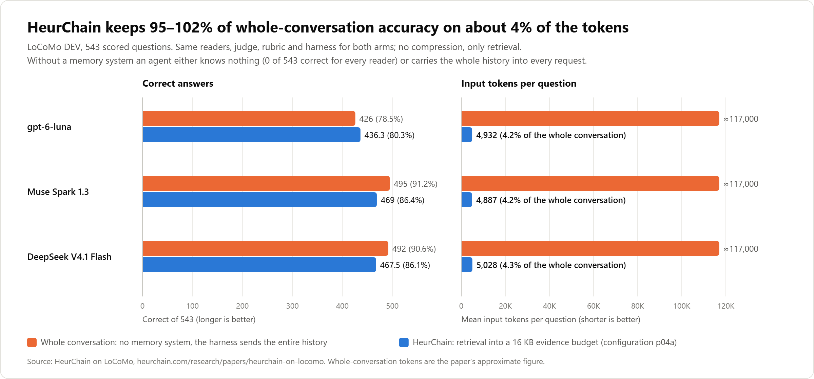
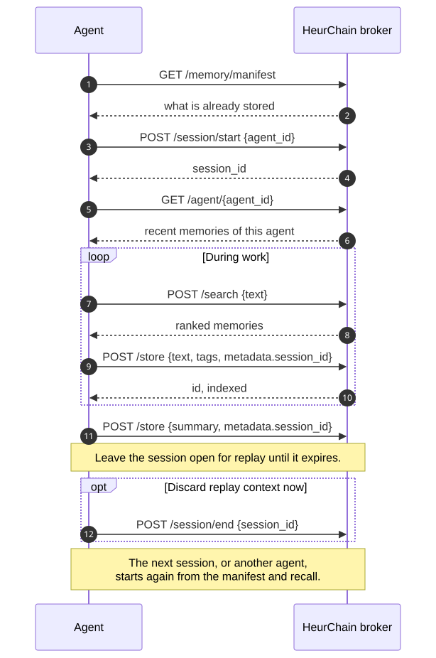

# HeurChain

**One memory system for every AI agent you run, on your own infrastructure.**

<!-- latest-update:start (keep README.md and npm/README.md identical; checked by tools/readme-banner.test.mjs) -->
> **Latest update: your agent now checks memory on its own.** Claude Code and Codex CLI can
> search HeurChain *before* they answer, without you asking them to. A small hook reads each
> prompt; when it looks like it depends on earlier work (a past decision, a release plan, a
> runbook), it runs a memory search and hands the agent the matching records together with
> your prompt. Prompts that stand on their own are never sent, and it is easy to turn off.
>
> One command connects the agent and installs the memory skill. Automatic recall
> is enabled by default only on qualified builds:
> `node tools/setup/cli.mjs connect --client claude --tenant <tenant_id> --apply`
> ([setup guide](https://github.com/peterjohannmedina/heurchain/blob/master/docs/agent-setup.md)). It works with the existing 0.6.1-oss.1 broker,
> with no broker upgrade. It is on by default for Claude Code 2.1.329 and Codex CLI 0.170.0 on
> Windows, the builds it was tested with; other versions and platforms can opt in.
<!-- latest-update:end -->

<!-- research:start (keep README.md and npm/README.md identical; checked by tools/readme-banner.test.mjs) -->
### Fewer tokens than carrying the whole history



On 543 scored LoCoMo development questions, HeurChain used about 4,900–5,000 input tokens per question versus about 117,000 with the full conversation (about 4% as many). Across three readers, scores ranged from 4.8 percentage points below the full-history baseline to 1.9 points above it.

Method, per-category results and comparisons with Mem0, Zep and others:
[HeurChain on LoCoMo](https://heurchain.com/research/papers/heurchain-on-locomo/) ·
[all HeurChain research papers](https://heurchain.com/research)
<!-- research:end -->

HeurChain is a persistent memory broker for AI agents. Claude Code, Codex, Gemini, local
models and any HTTP or MCP client share one store. They write facts, decisions and session
summaries, and later recall them with hybrid search: keyword (BM25) and meaning (dense
vectors), fused into one ranking.

> ### This package is the complete self-hosted HeurChain
>
> Everything a user or evaluator needs is in the package: the **memory broker** (Go source of
> broker 0.6.1-oss.1 with its Docker Compose stack: Redis, Qdrant and an Ollama embedder), a
> **`heurchain` CLI** that installs and runs it, and the **agent side**: MCP setup for Claude
> Code and Codex, the memory skill and the automatic recall hook. It needs Node 20+ and Docker
> Engine with Compose v2 (or Podman).
>
> ```sh
> npx heurchain init                 # unpack the server into ./heurchain-server
> npx heurchain up                   # build and start it (first run downloads images and the model)
> npx heurchain tenant --name "My team" --email me@example.com
> ```
>
> Versions 2.0.0 to 2.0.4 contained only the agent configuration files; 1.x was the old Node.js
> server (still installable as `heurchain@1`, see [Upgrading from 1.x](#upgrading-from-1x)).

Source and install guide: **https://github.com/peterjohannmedina/heurchain**

## How it works



The broker is one Go binary on one port. Agents reach it over **MCP** or **HTTP + JSON**,
and every request carries an API key and a tenant ID (one tenant per person, team or
project). Redis holds the memory records and the keyword index, Qdrant holds the vectors, an
embedder (Ollama or any OpenAI-compatible API) turns text into vectors, and a SQLite file
holds tenants, keys and the audit log. All of it runs on your machine.



- **Store**: embed the text, save the record in Redis, index it for keywords (Redis) and for
  meaning (Qdrant).
- **Recall**: search both indexes and fuse the two rankings with reciprocal rank fusion, so
  memories that match on exact words and on meaning come first.
- **Lifecycle**: memories that go unused fade; a background worker can move them into a
  vault that is kept and exportable but no longer searched (off until you enable it).

## Run the broker

Requirements: Node 20+ and Docker Engine with Compose 2.20 or later (Podman with
`podman compose` also works).

```sh
npx heurchain init        # ./heurchain-server: broker source, Compose stack, docs, and
                          # deploy/.env with a random admin password (mode 0600, not printed)
npx heurchain up          # prefer the prebuilt broker, prepare the model, wait for /ready
npx heurchain status      # GET /health
npx heurchain tenant --name "My team" --email me@example.com   # tenant ID and API key, shown once
```

Every command takes the server directory as an optional first argument (default
`./heurchain-server`). `init --port 18080` publishes the broker on another host port.

`up` pulls the prebuilt broker image (linux/amd64 and arm64) built from exactly the source in
this package, and compiles it only if the image cannot be pulled (`up --build` always
compiles). The largest download is the bundled Ollama embedder (about 3.3 GB). If you already
run an embedder, skip it, which brings the first download to about 0.5 GB:

```sh
npx heurchain init --embedder host-ollama     # Ollama already on this machine; up pulls nomic-embed-text into it
npx heurchain init --embedder openai --embed-url https://api.example.com/v1/embeddings --embed-model <model>
                                              # any OpenAI-compatible API; key from HEURCHAIN_EMBED_API_KEY
```

Choose the embedder before storing memories; vectors from different models are not comparable.
Running `npx heurchain@latest init` again in the same directory upgrades the code and keeps
`deploy/.env` and an edited `deploy/broker.yaml`. `npx heurchain down` stops the stack and
keeps its data.

The stack runs the broker, Redis, Qdrant and Ollama, published on `127.0.0.1` only. The
unpacked directory has the same layout as the GitHub repository, so
[docs/install.md](https://github.com/peterjohannmedina/heurchain/blob/master/docs/install.md)
(native systemd install, TLS, backups) applies to it unchanged. You can also clone the
repository and run `docker compose -f deploy/compose.yaml up -d --build` yourself.

## Wire your agent

**Claude Code or Codex CLI: one command.** It verifies the broker and key, adds the MCP entry,
installs the memory skill and, on qualified client builds, turns on automatic recall
([guide](https://github.com/peterjohannmedina/heurchain/blob/master/docs/agent-setup.md)):

```sh
HEURCHAIN_API_KEY=<api_key> npx heurchain connect --client claude --tenant <tenant_id> --apply
```

**Any other MCP or HTTP client:** every request sends two headers: `X-HeurChain-API-Key: <api_key>` and
`X-HeurChain-Tenant: <tenant_id>`.

**MCP (Streamable HTTP)**, for example Claude Code:

```sh
claude mcp add --transport http heurchain http://127.0.0.1:8080/mcp/sse \
  --header "X-HeurChain-API-Key: $KEY" --header "X-HeurChain-Tenant: $TENANT"
```

**HTTP**: `POST /store`, `POST /search`, `POST /query`, `POST /session/start`, and so on.
`GET /openapi.json` on your broker describes every endpoint.

**Let the agent set itself up.** Paste this to any agent:

```
Read the setup instructions in the heurchain npm package (README.md and
AGENT_CONFIG.json, https://www.npmjs.com/package/heurchain), then connect to the
HeurChain broker at http://<your-host>:8080 using the API key and tenant ID I give
you. Follow the session protocol in AGENT_CONFIG.json.
```

## Session protocol



1. `GET /memory/manifest`: see what is already stored before asking the user.
2. `POST /session/start` with your `agent_id`; pass the returned `session_id` as
   `metadata.session_id` on every store.
3. `GET /agent/{agent_id}`: recall your recent memories.
4. During work: `POST /search` before asking, `POST /store` for facts and decisions.
5. At the end, store a concise summary tagged `conversation` with your session ID.
   Leave the session open for replay until it expires. Use `POST /session/end`
   to discard its replay context immediately.

## What's in this package

| Path | For |
|---|---|
| `bin/heurchain.mjs` | The `heurchain` CLI: `init`, `up`, `status`, `tenant`, `connect`, `down` |
| `broker/` | Go source of the HeurChain broker 0.6.1-oss.1, built by the Compose stack |
| `deploy/` | Dockerfile, `compose.yaml` (broker, Redis, Qdrant, Ollama), `broker.yaml`, `.env.example`, systemd unit |
| `tools/setup/` | Agent setup: MCP entry, skill and automatic recall hook for Claude Code and Codex CLI |
| `skills/heurchain-memory/` | The memory skill (standing guidance for agents) |
| `docs/` | Install guide and agent setup guide |
| `AGENT_CONFIG.json` | Machine-readable manifest: auth headers, MCP and HTTP connection, session protocol, every HTTP operation and MCP tool of broker 0.6.1-oss.1 |
| `AGENT_ONBOARDING.md` | The broker's own agent guide (the same text it serves at `GET /`) |

```js
const config = require('heurchain/AGENT_CONFIG.json');
console.log(config.authentication.headers);
```

## Upgrading from 1.x

1.x was a Node.js server with its own Redis key layout (`doc:*`, `memory:*`, Obsidian/Ori
vault tiers). Broker 0.6.1 does not read 1.x data in place. Run the new broker alongside
the old one, with separate Redis instances, and re-store what you want to keep through
`POST /store`. Keep the 1.x deployment until you have checked the results. The 1.x versions
stay installable as `heurchain@1`.

## License

MIT
