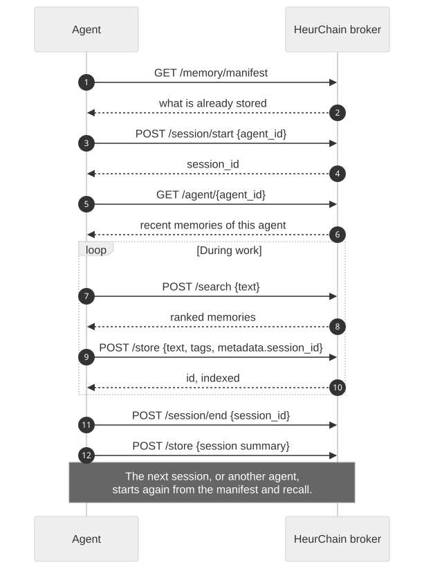

# HeurChain

**One memory system for every AI agent you run, on your own infrastructure.**

HeurChain is a persistent memory broker for AI agents. Claude Code, Codex, Gemini, local
models and any HTTP or MCP client share one store. They write facts, decisions and session
summaries, and later recall them with hybrid search: keyword (BM25) and meaning (dense
vectors), fused into one ranking.

> ### This package is the agent kit, not the server
>
> `npm install heurchain` gives you the files agents use to connect to a HeurChain broker:
> `AGENT_CONFIG.json` (a machine-readable manifest of the API, MCP tools and session
> protocol) and `AGENT_ONBOARDING.md`. **It does not run anything.**
>
> **To run HeurChain**, clone the GitHub repository and start it with Docker Compose. That
> repository is the complete self-hosted package: the Go broker 0.6.1-oss.1, Redis, Qdrant and an
> embedding model. See [Run the broker](#run-the-broker) below.
>
> Versions 1.x were a Node.js server. They are deprecated and still installable as
> `heurchain@1`; see [Upgrading from 1.x](#upgrading-from-1x).

Source and install guide: **https://github.com/peterjohannmedina/heurchain**

## How it works



The broker is one Go binary on one port. Agents reach it over **MCP** or **HTTP + JSON**,
and every request carries an API key and a tenant ID (one tenant per person, team or
project). Redis holds the memory records and the keyword index, Qdrant holds the vectors, an
embedder (Ollama or any OpenAI-compatible API) turns text into vectors, and a SQLite file
holds tenants, keys and the audit log. All of it runs on your machine.



- **Store**: embed the text, save the record in Redis, index it for keywords (Redis) and for
  meaning (Qdrant).
- **Recall**: search both indexes and fuse the two rankings with reciprocal rank fusion, so
  memories that match on exact words and on meaning come first.
- **Lifecycle**: memories that go unused fade; a background worker can move them into a
  vault that is kept and exportable but no longer searched (off until you enable it).

## Run the broker

Requirements: Docker Engine with Compose v2.

```sh
git clone https://github.com/peterjohannmedina/heurchain.git
cd heurchain
cp deploy/.env.example deploy/.env      # set ADMIN_USER and a long random ADMIN_PASS
docker compose -f deploy/compose.yaml up -d --build
docker compose -f deploy/compose.yaml exec ollama ollama pull nomic-embed-text
curl -s http://127.0.0.1:8080/health
```

The stack runs the broker, Redis, Qdrant and Ollama, published on `127.0.0.1` only. These
steps are tested end to end on every broker or deploy change. The full guide (native
systemd install, TLS, backups) is
[docs/install.md](https://github.com/peterjohannmedina/heurchain/blob/master/docs/install.md).

Create a tenant and API key (the key is shown once):

```sh
curl -s -u "$ADMIN_USER:$ADMIN_PASS" -X POST http://127.0.0.1:8080/admin/tenants \
  -H 'Content-Type: application/json' -d '{"name":"My team","email":"me@example.com"}'
```

## Wire your agent

Every request sends two headers: `X-HeurChain-API-Key: <api_key>` and
`X-HeurChain-Tenant: <tenant_id>`.

**MCP (Streamable HTTP)**, for example Claude Code:

```sh
claude mcp add --transport http heurchain http://127.0.0.1:8080/mcp/sse \
  --header "X-HeurChain-API-Key: $KEY" --header "X-HeurChain-Tenant: $TENANT"
```

**HTTP**: `POST /store`, `POST /search`, `POST /query`, `POST /session/start`, and so on.
`GET /openapi.json` on your broker describes every endpoint.

**Let the agent set itself up.** Paste this to any agent:

```
Read the setup instructions in the heurchain npm package (README.md and
AGENT_CONFIG.json, https://www.npmjs.com/package/heurchain), then connect to the
HeurChain broker at http://<your-host>:8080 using the API key and tenant ID I give
you. Follow the session protocol in AGENT_CONFIG.json.
```

## Session protocol



1. `GET /memory/manifest`: see what is already stored before asking the user.
2. `POST /session/start` with your `agent_id`; pass the returned `session_id` as
   `metadata.session_id` on every store.
3. `GET /agent/{agent_id}`: recall your recent memories.
4. During work: `POST /search` before asking, `POST /store` for facts and decisions.
5. At the end: `POST /session/end`, then store a concise summary.

## What's in this package

| File | For |
|---|---|
| `AGENT_CONFIG.json` | Machine-readable manifest: auth headers, MCP and HTTP connection, session protocol, every HTTP operation and MCP tool of broker 0.6.1-oss.1 |
| `AGENT_ONBOARDING.md` | The broker's own agent guide (the same text it serves at `GET /`) |
| `README.md` | This file |

```js
const config = require('heurchain/AGENT_CONFIG.json');
console.log(config.authentication.headers);
```

## Upgrading from 1.x

1.x was a Node.js server with its own Redis key layout (`doc:*`, `memory:*`, Obsidian/Ori
vault tiers). Broker 0.6.1 does not read 1.x data in place. Run the new broker alongside
the old one, with separate Redis instances, and re-store what you want to keep through
`POST /store`. Keep the 1.x deployment until you have checked the results. The 1.x versions
stay installable as `heurchain@1`.

## License

MIT
